<p align="center">
  
</p>

<p align="center"><b>Paste a trading tip, a chart screenshot or an influencer clip. Get back whether it survives contact with real market history.</b></p>

<p align="center">
  
  
  
</p>
<p align="center">
  
  
  
</p>

> Retail traders lose real money on strategies nobody ever tested: an RSI rule with a "80% win rate", a weekend pump, a breakout that "works every time". Testing one properly takes a quant an afternoon. Falsify does it in seconds, and its default answer is that the claim is wrong until the data says otherwise.

## Try it in one command

```bash
git clone https://github.com/Makabeez/falsify && cd falsify
make judge-demo          # creates a venv, verifies data hashes, runs every claim in claims/
```

No API key, no network after install. The demo checks every bundled price file against `data/manifest.json` (SHA-256) and refuses to run if one was altered.

## Why the model doesn't write the backtest

LLM-written backtests lie in a specific way: a signal computed on bar *t* filled at bar *t*'s close, an indicator that peeks one bar ahead, a stop that fills at the level after a gap. The output looks great and is fiction.

So Falsify splits the job:

```
  claim (text | screenshot | .mp4)
        │
        ▼
  ┌────────────────────────┐   screenshots and clips only
  │ Muse Spark: TRANSCRIBE │── verbatim visible text + speech: the record quotes are checked against
  └────────────────────────┘
        │
        ▼
  ┌────────────────────────┐   structured output, constrained decoding
  │ Muse Spark: COMPILE    │── ClaimSpec JSON (typed DSL, no code) + one evidence row per rule element
  └────────────────────────┘
        │                    ▲
        ▼                    │ schema error or failed quote → sent back, max 2 repairs
  ┌────────────────────────┐ │
  │ Validate + QUOTE CHECK │─┘ deterministic: every rule element quoted verbatim from the source,
  └────────────────────────┘   or declared assumed. Paraphrases are refused.
        │
        ▼
  ┌────────────────────────┐
  │ Muse Spark: AUDIT      │── source + spec → every place the spec departs from what was said
  └────────────────────────┘
        │
        ▼
  ┌────────────────────────┐   deterministic, no model in the P&L path
  │ Engine                 │── signal at close t → fill at open t+1, pessimistic stops, real costs
  └────────────────────────┘
        │
        ▼
  ┌────────────────────────┐
  │ Falsification battery  │── costs · random-entry null · post-claim window · halves · 11 other assets · every reading of vague params
  └────────────────────────┘
        │
        ▼
     SURVIVES | DIES | INCONCLUSIVE | UNTESTABLE   + "7/9 rule elements quoted from the claim, 2 assumed"
```

The model's job is translation, which it is good at. It never gets the last word on either side of it:

- **What the claimant said** is checked by `falsify/grounding.py`. Every entry and exit condition, stop, target, time exit, asset, timeframe and direction needs an evidence row with the claimant's exact words, or an explicit `assumed: true`. A quote that isn't literally in the post (or in the transcript of the screenshot or clip) is refused and sent back. The verdict then tells you how much of what was tested is the claimant's rule and how much is our reading.
- **What the rule does** is computed by code whose timing contract is pinned by tests (`tests/test_engine.py`), including a check that truncating future data never changes a past trade.

## The battery

| Test | Question it asks | Effect on verdict |
|---|---|---|
| Costs | Does it make money after 10 bps fee + 2 bps slippage per side? | Fatal if not |
| Random-entry null | Do random entries with the same number of trades, holding times and side do as well? Strips out market drift: a long-only rule in a bull market beats zero but not random longs. 2,000 simulations. | Fatal if p ≥ 0.05 |
| Post-claim window | If the claim shows a period, what happened after it? The only truly out-of-sample data. | Fatal if it loses (≥ 10 trades) |
| Sample size | At least 30 trades? | INCONCLUSIVE below |
| Halves | Is the edge positive in both halves of history? | Warning |
| Cross-asset | Does it work on the other 11 bundled assets? | Warning |
| Vague parameters | "Oversold" could mean 20, 25, 30 or 35. Every reading is run; picking the best one pays a Bonferroni penalty. | Warning |
| Claimed vs measured | Claimed 80% win rate, measured 61%. | Warning |
| Buy-and-hold | Would just holding have done better? | Warning |

Thresholds are fixed statistical conventions (p < 0.05, n ≥ 30), stated before any claim is run, never tuned per claim.

## What it says about some classic setups

From `make judge-demo` (Binance spot, 2019-01-01 to 2026-10-26, costs included):

| Claim (hand-compiled, generic) | Verdict | Why |
|---|---|---|
| ETH 4h: buy RSI oversold, sell overbought, "80% win rate" | **DIES** | 64 trades, 61% win rate, −1.72% per trade, −85% total; random timing beat it 97% of the time |
| Buy BTC after a 10% weekly drop, hold 7 days | **DIES** | +1.16% per trade, but random 7-day longs did as well 46% of the time |
| Buy SOL Friday close, sell Monday open | **DIES** | +0.78% per trade over 323 weekends, but random 2-day holds did as well 14% of the time |
| BTC 4h breakout above 20-bar high on 2× volume, 3% stop / 6% target | **DIES** | 38% win rate, +0.20% per trade, indistinguishable from random entries (p = 0.45) |
| BTC daily golden cross / death cross | **INCONCLUSIVE** | 7 trades since 2019; buy-and-hold made +2066% vs +324% |
| "Accumulate strong projects when smart money buys" | **UNTESTABLE** | No mechanical trigger |

## With Muse Spark

```bash
cp .env.example .env          # add MODEL_API_KEY from dev.meta.ai
set -a; . ./.env; set +a
.venv/bin/falsify ping                  # key works, models listed, one structured call
.venv/bin/falsify check --text "Buy ETH when RSI drops under 30 on the 4h, sell above 70. 80% win rate."
.venv/bin/falsify check screenshot.png --note "posted on X, Oct 2026"
.venv/bin/falsify check clip.mp4
.venv/bin/falsify extract screenshot.png -o claims/my_claim.json   # compile + audit only
```

| Meta model | Role |
|---|---|
| `muse-spark-1.3` | Transcribes screenshots; compiles text and screenshots into a quote-backed `ClaimSpec` with structured output; audits the spec against the source |
| `muse-spark-1.2` | Same three passes for video clips (the 1.3 docs flag audio understanding as degraded; pitches live in the speech) |

## Real vs. simulated

| Component | Status |
|---|---|
| Price history | **Real.** Binance spot klines from the public market-data API, 12 assets × 1h/4h/1d, pinned snapshot + SHA-256 manifest |
| Costs | **Modeled.** 10 bps fee + 2 bps slippage per side (Binance spot taker), configurable |
| Shorts | **Modeled.** Priced as spot short with no borrow or funding cost |
| Example claims in `claims/` | **Hand-compiled** paraphrases of common retail setups. No real posts, no authors |
| Muse Spark transcribe/compile/audit | Wired to Meta Model API; repair loop and quote check tested against a mock client (`tests/test_grounding.py`). Live runs and the extraction-accuracy measurement land in the next commits |

## Known limits

- **Power.** Low-frequency rules (a few dozen trades since 2019) rarely clear p < 0.05 even when real. The battery is built to reject, and a test that kills everything is as useless as one that passes everything. `tests/test_battery.py` shows it flags a planted timing edge at p < 0.01; a measured power curve is next.
- **Bar-close logic only.** Intrabar claims ("buy the wick") are approximated at the next open.
- **Spot data.** No funding rates, order flow, sentiment or news; claims that need them are reported UNTESTABLE rather than approximated.
- Not financial advice. A claim that SURVIVES has passed tests, not earned your money.

## Built during the hackathon

Everything in this repository was written during the Meta Global AI Developer Hackathon (26 Oct – 4 Nov 2026). The first commit is the empty kickoff commit of 26 Oct; the git history is the build log. No code from earlier projects is reused.

## Data attribution

Market data: Binance public market-data API (`data-api.binance.vision`). Rebuild with `make data`.

## License

MIT
